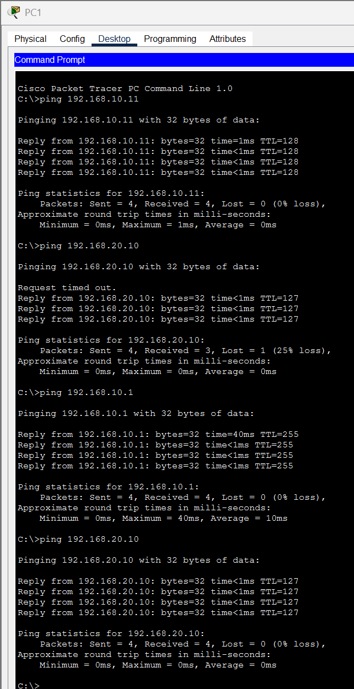
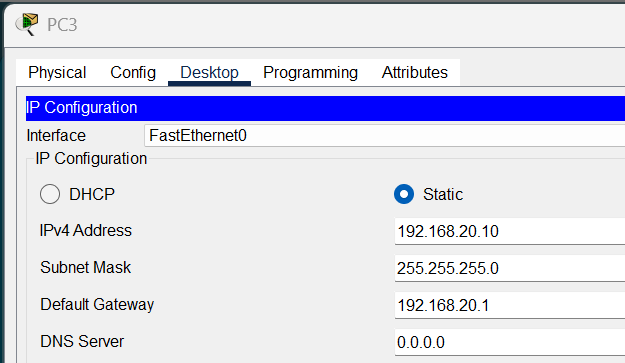
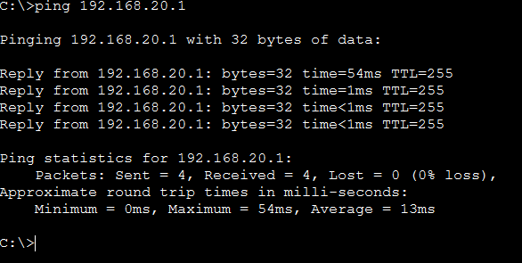
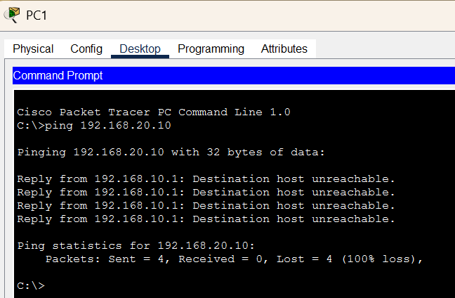
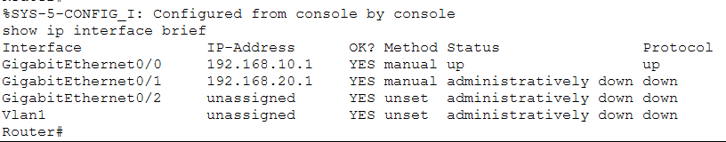

# Cisco Packet Tracer Network Troubleshooting Lab

## Overview
This lab was built in Cisco Packet Tracer to simulate a small enterprise network environment.

The network consists of:
- Cisco 2911 Router
- Two Cisco 2960 Switches
- Four Endpoints
- Two Subnets

The objective of this lab is to configure, validate, troubleshoot, and resolve common network issues using Cisco's IOS and standard network troubleshooting techniques. 

## Skills Demonstrated
- TCP/IP
- Routing
- Cisco IOS
- Network Troubleshooting
- Root Cause Analysis
- ICMP Testing
- Techincal Documentation

## Network Topology

The lab topology consists of one Cisco 2911 router, two Cisco 2960 switches, and four PCs.

## Router Configuration Verification

Verified GigabitEthernet0/0 and GigabitEthernet0/1 were operational and configured correctly.

## Connectivity Validation

Confirmed successful local and remote network connectivity using ICMP testing.

## Troubleshooting Incidents 

### Incident 001 - Incorrect Default Gateway 

#### Symptoms

PC3 successfully communicated with local devices on the 192.168.20.0/24 subnet.
Communication to remote networks failed.

Evidence:
- Successful ping to PC4
- Failed ping to PC1

#### Investigation

IP configuration was examined on PC3.
An incorrect default gateway was indentified.
Expected Gateway: 192.168.20.1
Configured Gateway: 192.168.20.254

#### Resolution

The default gateway was corrected from 192.168.20.254 to 192.168.20.1

#### Verification

Connectivity to remote networks was restored.
PC3 successfully communicated with hosts located on the 192.168.10.0/24 subnet. Issue resolved. 

### Incident 002 - Router Interface Shutdown

#### Symptoms 

Users were unable to communicate with hosts located on the 192.168.20.0/24 network.

Evidence:
- Failed ping from PC1 to PC3
- Remote subnet inaccesible

#### Investigation

Router interface status was examined using:

show ip interface brief

GigabitEthernet0/1 was found in an administratively down state

#### Resolution

The disabled interface was re-enabled using:

interface g0/1 no shutdown

#### Verification

Connectivity to the remote subnet was restored.

GigabitEthernet0/1 returned to an operational state and ICMP communication was successful.
<!-- insert screenshot and troubleshooting -->