# Cisco Packet Tracer Network Troubleshooting Lab

## Overview
This lab was built in Cisco Packet Tracer to simulate a small enterprise network environment.

The network consists of:
- Cisco 2911 Router
- Two Cisco 2960 Switches
- Four Endpoints
- Two Subnets

The objective of this lab is to configure, validate, troubleshoot, and resolve common network issues using Cisco's IOS and standard network troubleshooting techniques. 

## Skills Demonstrated
- TCP/IP
- Routing
- Cisco IOS
- Network Troubleshooting
- Root Cause Analysis
- ICMP Testing
- Techincal Documentation

## Network Topology
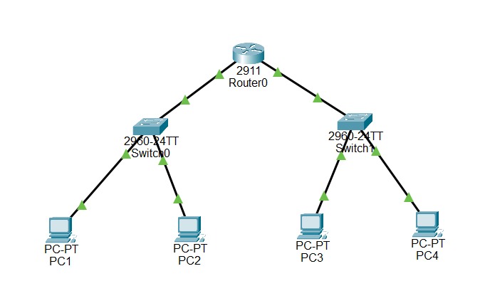

The lab topology consists of one Cisco 2911 router, two Cisco 2960 switches, and four PCs.

## Updated Network Topology
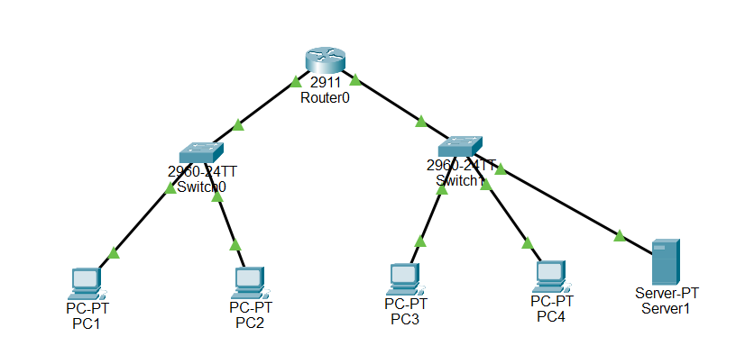

Added a server to the network topology to provide DNS services for name resolution testing and troubleshooting. 

## DNS Service Configuration

A server was added to the network to provide internal DNS services.

Server Configuration:
- IP Address: 192.168.20.100
- Subnet Mask: 255.255.255.0
- Default Gateway: 192.168.20.1

DNS Record:
- fileserver.local --> 192.168.20.100

## DNS Baseline Validation
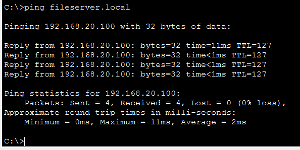

A DNS lookup was validated by succesfully resolving the hostname fileserver.local to its configured IP address.

### Test Performed
- ping fileserver.local

### Result
- Success

The successful response confirmed that the DNS service was functioning correctly and was ready for troubleshooting scenarios involving name resolution failures.

## Router Configuration Verification
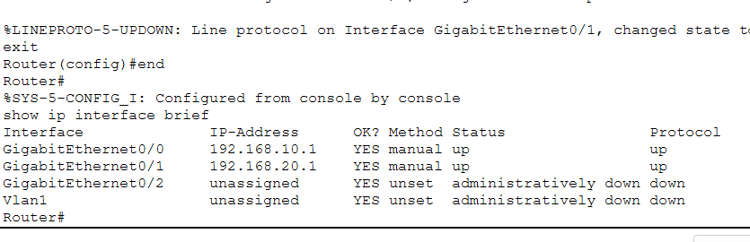

Verified GigabitEthernet0/0 and GigabitEthernet0/1 were operational and configured correctly.

## Connectivity Validation

Confirmed successful local and remote network connectivity using ICMP testing.

## Troubleshooting Incidents 

### Incident 001 - Incorrect Default Gateway 

#### Symptoms
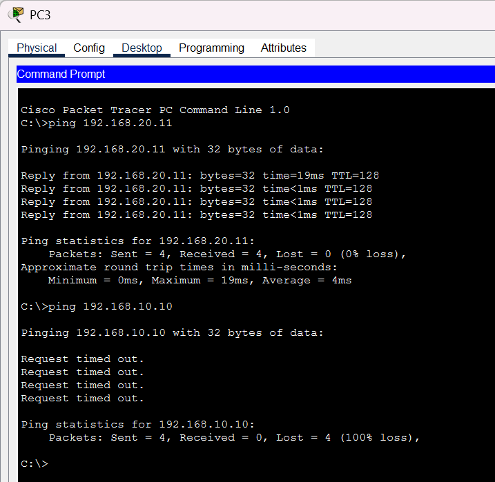

PC3 successfully communicated with local devices on the 192.168.20.0/24 subnet.
Communication to remote networks failed.

Evidence:
- Successful ping to PC4
- Failed ping to PC1

#### Investigation
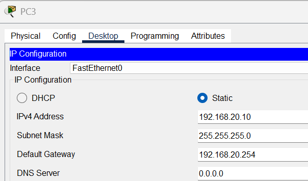

IP configuration was examined on PC3.
An incorrect default gateway was indentified.
Expected Gateway: 192.168.20.1
Configured Gateway: 192.168.20.254

#### Resolution

The default gateway was corrected from 192.168.20.254 to 192.168.20.1

#### Verification

Connectivity to remote networks was restored.
PC3 successfully communicated with hosts located on the 192.168.10.0/24 subnet. Issue resolved. 

### Incident 002 - Router Interface Shutdown

#### Symptoms 

Users were unable to communicate with hosts located on the 192.168.20.0/24 network.

Evidence:
- Failed ping from PC1 to PC3
- Remote subnet inaccesible

#### Investigation

Router interface status was examined using:

show ip interface brief

GigabitEthernet0/1 was found in an administratively down state

#### Resolution
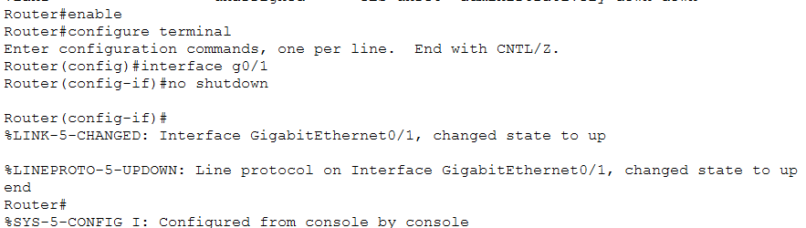

The disabled interface was re-enabled using:

interface g0/1 no shutdown

#### Verification
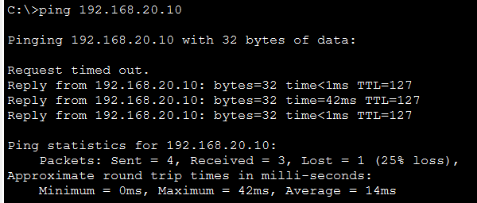

Connectivity to the remote subnet was restored.

GigabitEthernet0/1 returned to an operational state and ICMP communication was successful.

### Incident 003 - IP Address Misconfiguration

#### Symptoms
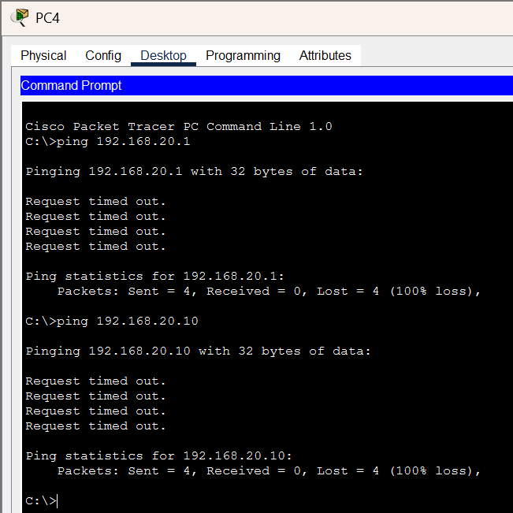

PC4 was unable to communicate with local network devices.

Evidence:
- Failed ping to the default gateway.
- Failed ping to PC3.

#### Investigation
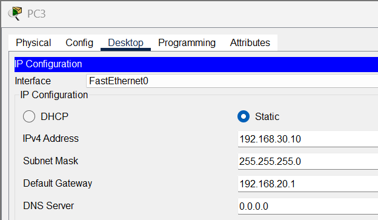

A review of endpoint network settings identified an incorrect IP address assignment.

Expected: 192.168.20.11
Actual: 192.168.30.11

#### Resolution
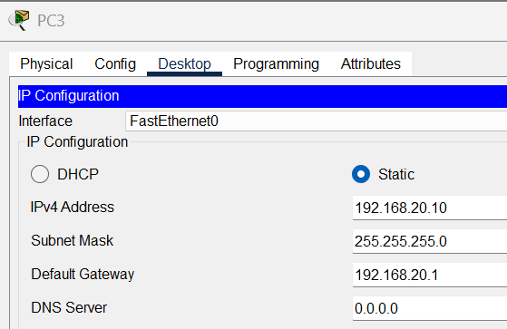

The endpoint IP address was corrected from 192.168.30.11 to 192.168.20.11.

#### Verification
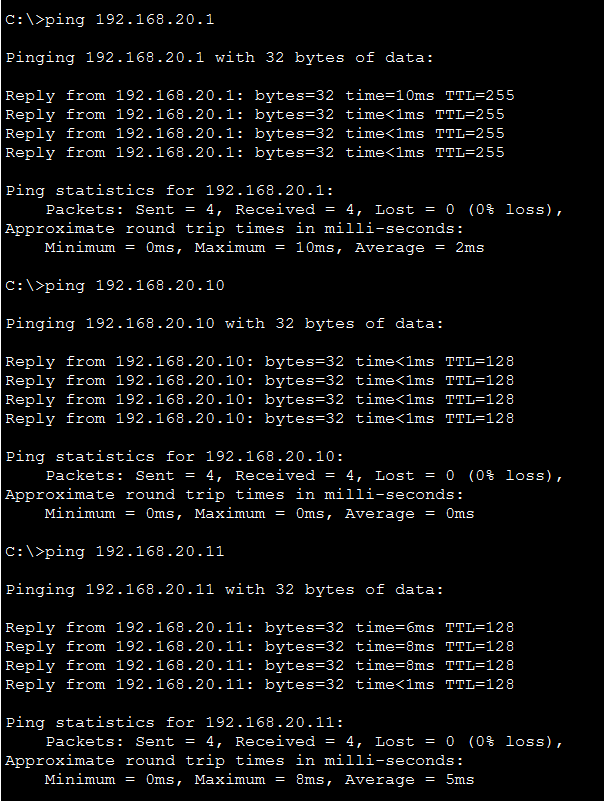

Connectivity was successfully restored. PC4 was able to communicate with the default gateway and other hosts on the local subnet.

### Incident 004 - Incorrect DNS Server Configuration

#### Symptoms
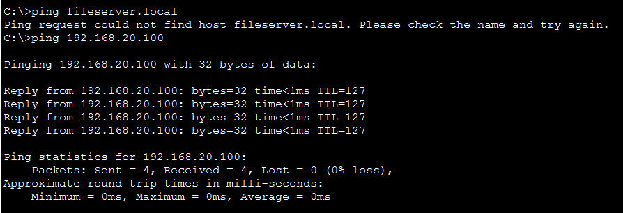

Users were unable to reach network resources using hostnames.

Evidence:
- Hostname resolution failed.
- Direct Communication using IP addresses remained successful.

#### Investigation
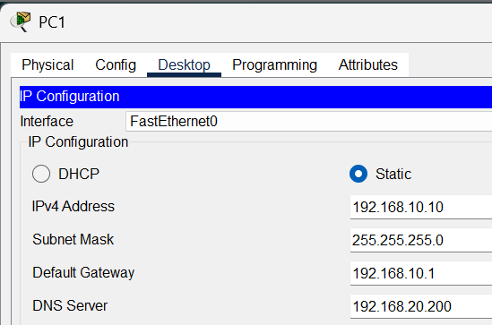

The workstation DNS configuration was reviewed.
- Expected DNS Sever: 192.168.20.100
- Configured DNS Server: 192.168.20.200

#### Resolution
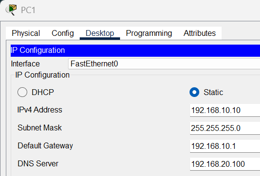

The DNS server address was corrected to 192.168.20.100

#### Verification
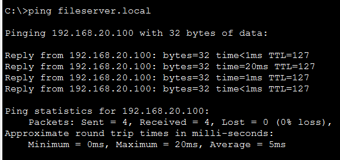

Hostname resolution was restored. The work station successfully resolved fileserver.local and communicated with the server.
<!-- insert screenshot and troubleshooting -->